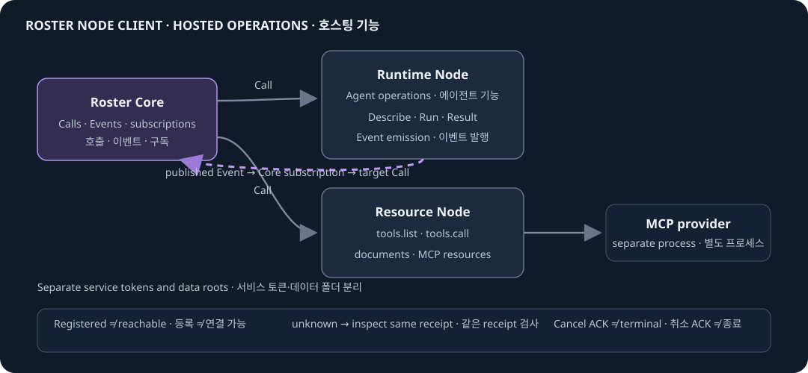

# 로스터 노드 클라이언트

[English](README.md) | [한국어](README.ko.md)

중앙 Roster Core가 명세를 조회하고 호출할 수 있는 operation을 제공합니다. `runtime/`은 Agent·script 기능을 실행하고, `resource/`는 문서와 MCP 도구를 제공하며, `contracts/`는 공유 Node.js schema를 관리합니다. 별도 Python client는 계획 상태이며 아래 실행 안내의 범위에 포함되지 않습니다.



## 로컬 실행

필요 도구는 Node.js 24, npm, Go 1.26입니다. 자격과 쓰기 가능한 데이터 폴더는 저장소 밖에 둡니다. Runtime의 `ROSTER_TOKEN`은 24자 이상이어야 합니다. Resource의 `ROSTER_RESOURCE_TOKEN`과 `ROSTER_RESOURCE_ADMIN_TOKEN`은 서로 다르고 각각 32자 이상이어야 합니다.

`ROSTER_TOKEN`과 쓰기 가능한 `ROSTER_DATA_DIR`을 설정한 뒤 Runtime을 실행하세요.

```sh
cd runtime
npm ci
npm run build
node dist/main.js
```

다른 터미널에서 Resource 전용 `ROSTER_DATA_DIR`과 `ROSTER_RESOURCE_TOKEN`, `ROSTER_RESOURCE_ADMIN_TOKEN`을 설정한 뒤 실행합니다.

```sh
cd resource
go run ./cmd/roster-resource-server
```

기본 loopback 주소는 Runtime `127.0.0.1:7331`, Resource `127.0.0.1:7340`입니다. 두 프로세스의 데이터 폴더와 자격을 분리하세요. 원격 Resource listener에는 TLS 인증서·키가 필요하며 원격 Runtime은 명시적인 TLS proxy가 필요합니다. Core는 공급자의 HTTPS 주소로 outbound 연결합니다. Node 등록이나 health 응답만으로 개별 Call의 성공이 증명되지는 않습니다.

## 준비된 서비스 함께 시작하기

`runtime/`에서 `npm ci && npm run build`로 Runtime을 빌드하고 `resource/`에서 Resource를 빌드하세요. Windows에서는 `go build -o roster-resource-server.exe ./cmd/roster-resource-server`, Linux에서는 출력 이름을 `roster-resource-server`로 사용합니다. 저장소 **밖에** 권한을 제한한 설정 JSON과 별도 env JSON을 만들고 저장소 루트에서 실행합니다.

```sh
node scripts/launch.mjs --config ../local-config/node-client.json
```

설정에는 `schema: "roster-launch/1"`, `data_root`, `env_file`, `runtime_entry`(절대 경로인 `runtime/dist/main.js`), `resource_binary`를 지정합니다. `runtime_port`, `resource_port`, `agent_module`은 선택 항목입니다. env 파일 형식은 `{ "env": { "ROSTER_TOKEN": "...", "ROSTER_RESOURCE_TOKEN": "...", "ROSTER_RESOURCE_ADMIN_TOKEN": "..." } }`입니다. 외부 파일에 서로 다른 실제 토큰을 지정하세요. Launcher는 기본 loopback 7331·7340 포트에서 서비스 준비 상태를 확인하고, 외부 data root 아래에 Runtime·Resource 데이터를 분리합니다. 그룹 실행·종료는 Linux Docker에서 검증했으며 Windows ACL·signal 동작은 아직 검증하지 않았습니다.

## Agent 또는 MCP Resource 추가

Runtime은 신뢰하는 로컬 ES module을 `agent_module`에서 불러옵니다. 모듈은 `createAgents(options)`를 내보내고 선언된 Agent 구현을 반환합니다. 기동 중 모듈 코드를 가져와 실행하므로 공급자 코드로 취급하고 먼저 검토하세요. 다음 예제는 모델 호출 없이 요청을 처리합니다.

```js
export function createAgents(options = {}) {
  return [{
    spec: { id: 'custom-echo', name: String(options.name || 'Echo'), description: 'Local request echo',
      statuses: ['done'], events: ['complete'], skills: [], rules: [], capabilities: [] },
    async execute(invocation, context) {
      context.signal.throwIfAborted();
      return { status: 'done', summary: 'Request received',
        output: { request: invocation.context.request },
        events: [{ type: 'complete', data: {} }], artifacts: [], metrics: {} };
    },
  }];
}
```

외부 launcher 설정의 `agent_module`에 `.mjs` 경로를 지정합니다. `{ "name": "Local helper" }` 같은 `agent_options`는 Runtime에만 전달됩니다. [Runtime parameter 예제](runtime/examples/parameter-agent.ts)는 작성자용 타입 계약을 보여줍니다. `target_id: "custom-echo"`인 Runtime Node로 등록한 뒤 선언된 `run` operation을 호출하세요. 등록, Describe, Call 결과를 각각 확인합니다.

커스텀 Resource는 별도 프로세스로 Streamable HTTP MCP 서버를 실행하고 그 서버에서 bearer 자격을 검증합니다. [Go SDK fixture](resource/internal/adapters/mcpclient/factory_test.go)에 서버와 도구 예제가 있습니다. Resource가 endpoint에 연결해 `tools.list`와 `tools.call`을 처리합니다. 정의 파일은 Git 밖에 두고 `ROSTER_RESOURCE_ADMIN_TOKEN`으로 등록합니다.

```sh
node resource/scripts/resource.mjs register definition.json
```

```json
{"id":"custom-mcp","name":"Custom MCP","component":"mcp","endpoint":"http://127.0.0.1:7440/mcp","credential_env":"CUSTOM_MCP_TOKEN","version":0}
```

`CUSTOM_MCP_TOKEN`을 Resource의 권한 제한 env 파일로 주입하세요. 그룹 launcher에서는 `resource_provider_env`에 이름을 나열하면 해당 값은 Resource에만 전달됩니다. 서비스 토큰으로 `node resource/scripts/resource.mjs invoke custom-mcp operation.json`을 실행할 수 있습니다. 등록 후 version 1을 받았다면 `operation.json`은 `{"name":"tools.call","tool":"echo","arguments":{"text":"hello"},"expected_version":1}` 형태를 사용합니다. Core에는 `target_id: "custom-mcp"`와 Resource URL을 가진 별도 Resource Node를 등록하고 `tools.list`·`tools.call`을 확인하세요. 등록만으로 MCP 도구 실행 성공이 증명되지는 않습니다.

## 검증

각 구성요소에서 Docker 모듈 검사와 패키지 빌드를 별도로 실행합니다.

```sh
# runtime/ 또는 contracts/
docker run --rm -v "$PWD:/src" -w /src node:24-bookworm-slim sh -c "npm ci && npm test"

# resource/
docker run --rm -v "$PWD:/src:ro" -w /src golang:1.26 go test ./...
```

구성요소 사용법: [Runtime](runtime/README.md), [Resource](resource/README.md), [Contracts](contracts/README.md). 기여 안내: [CONTRIBUTING](CONTRIBUTING.md).
